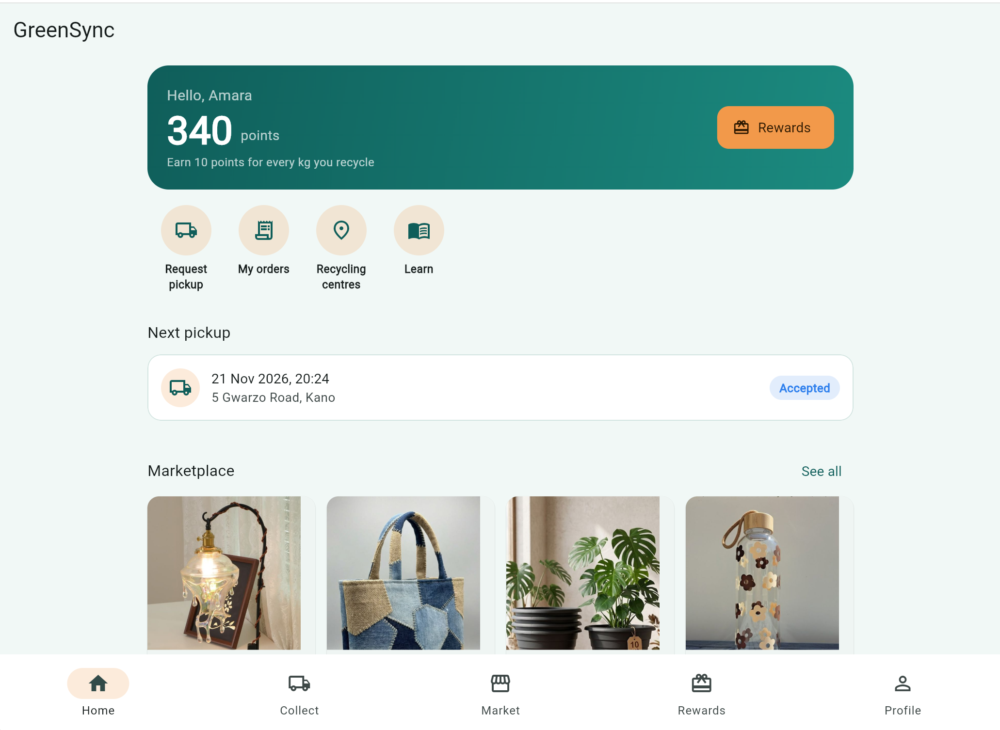
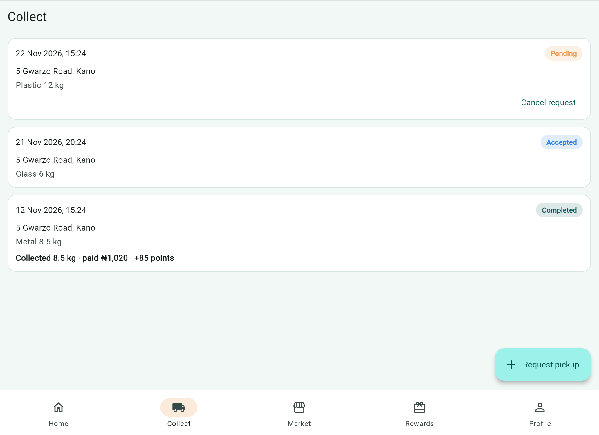
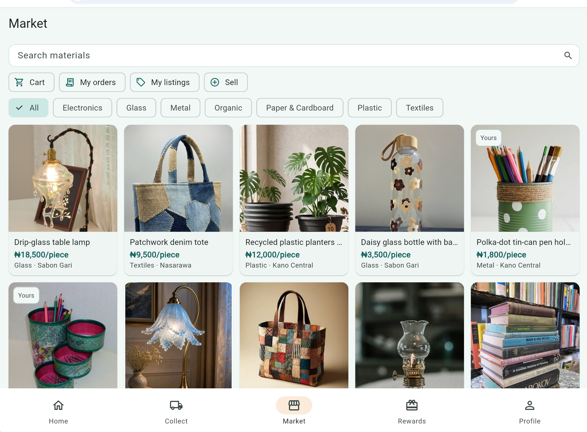
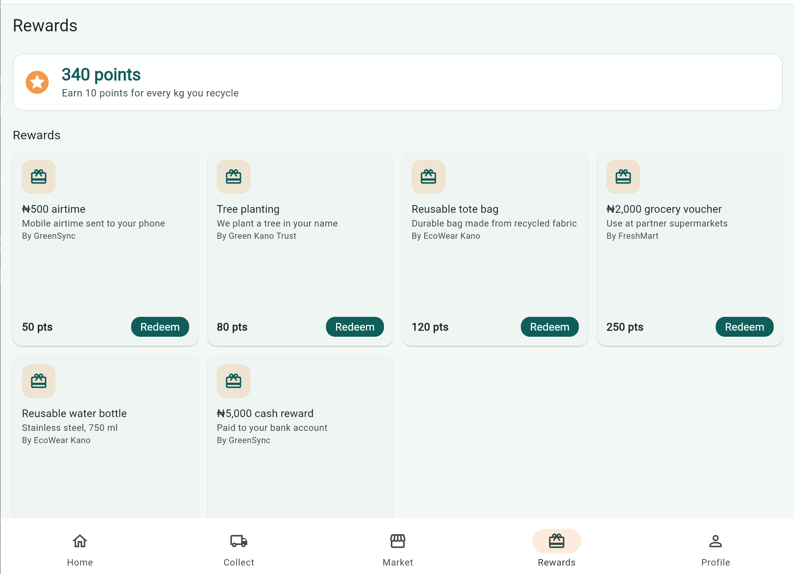
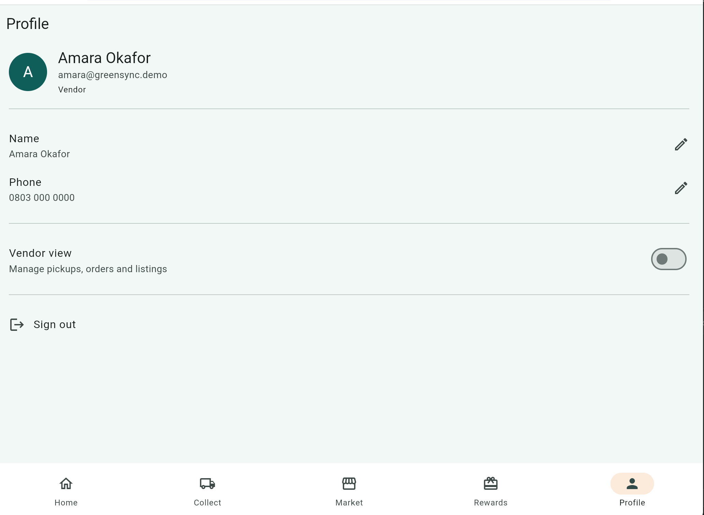
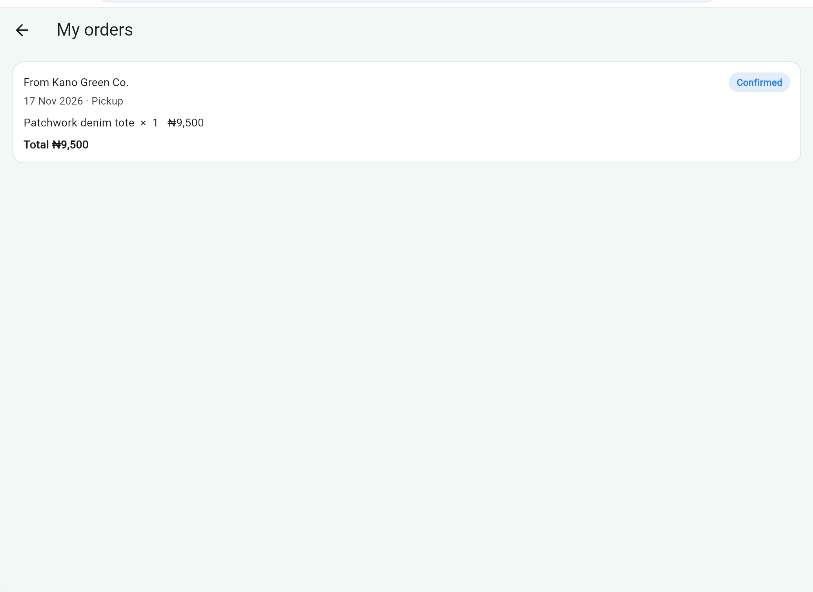
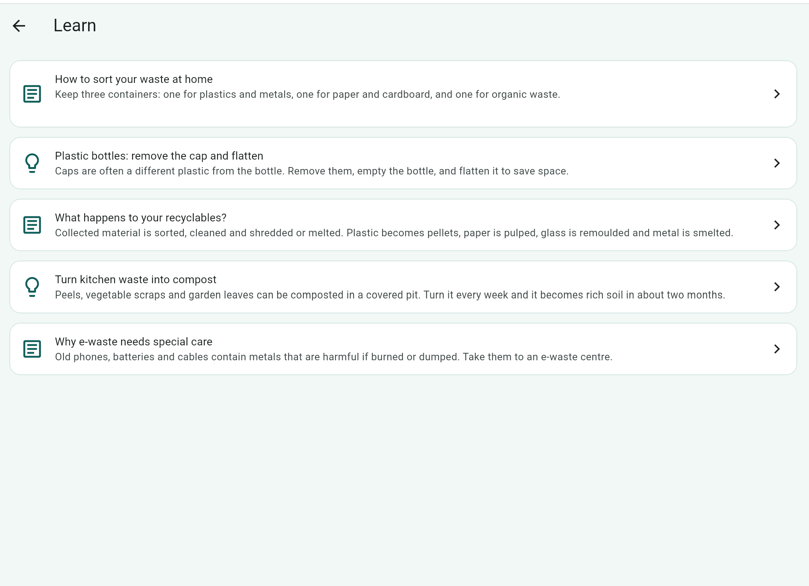
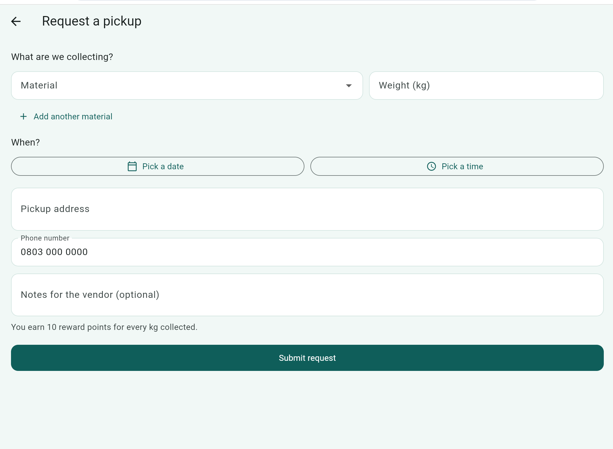
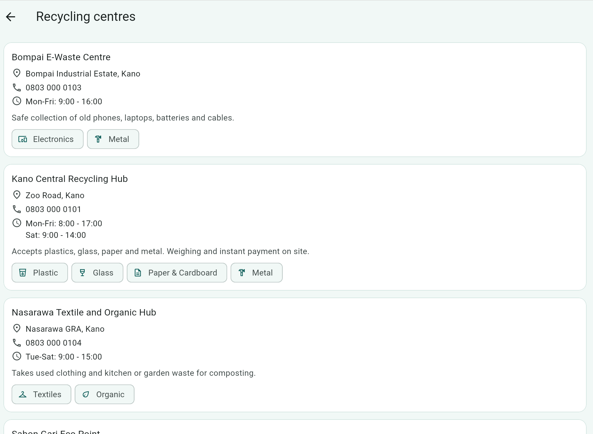

# 🌱 GreenSync

**A waste-collection and recycled-goods marketplace app, built with Flutter and Supabase.**

GreenSync connects households with waste collectors, rewards people for recycling, and gives recycled products a marketplace, so waste becomes income instead of litter.


---

✨ Features

 For customers
- **Request a pickup**: schedule a waste collection and attach photos.
- **Track requests**: follow a pickup from *pending* to *accepted* to *completed*.
- **Marketplace**: browse recycled goods, add to cart, place orders, and sell your own items.
- **Rewards**: earn **10 points for every kg** you recycle and redeem them for sponsored rewards.
- **Recycling centres**: find nearby drop-off points by material type.
- **Learn**: articles, tips, and videos on recycling and waste reduction.

### For vendors
- **Dashboard** with an overview of activity.
- **Pickup requests**: accept and complete collection jobs.
- **Orders**: confirm and fulfil marketplace orders (pickup or delivery).
- **Listings**: create and manage products for sale.
- Vendor accounts go through an **application and approval** flow.

---

## 🚀 Quick start: Demo mode (no setup needed)

Run the app with **no backend keys** and it starts in demo mode. You're signed in as a demo user and every screen works on built-in sample data. Nothing is saved and nothing leaves your device.

```bash
git clone https://github.com/ummieh/GreenSync.git
cd GreenSync
flutter pub get
flutter run
```

> Requires the [Flutter SDK](https://docs.flutter.dev/get-started/install) (Dart `^3.6.0`).

---

## 🔌 Run with the real backend (Supabase)

### 1. Create a Supabase project
Create a free project at [supabase.com](https://supabase.com).

### 2. Set up the database
In the Supabase **SQL Editor**, run these files **in order**:

| Order | File | Purpose |
|------:|------|---------|
| 1 | `supabase/01_schema.sql` | Tables, enums, rules, and functions |
| 2 | `supabase/02_storage.sql` | Storage buckets and access policies |
| 3 | `supabase/03_demo_data.sql` | Sample rewards, centres, articles, listings, and pickups |
| 4 | `supabase/04_make_me_vendor.sql` | *(Optional)* Makes your account a vendor + 300 demo points. **Replace `YOUR_EMAIL` first.** |

Then go to **Authentication → Sign In / Providers → Email** and turn off **Confirm email** while testing.

### 3. Run the app with your keys

```bash
flutter run \
  --dart-define=SUPABASE_URL="https://YOUR_PROJECT_REF.supabase.co" \
  --dart-define=SUPABASE_ANON_KEY="YOUR_PUBLISHABLE_KEY"
```

> 🔒 **Only ever use the anon / publishable key in the app.** Never put the `service_role` / secret key in client code or commit it to Git.

---

## 🗂️ Project structure

```
GreenSync/
├── lib/
│   ├── main.dart
│   ├── core/            # demo backend, Supabase service, theme, utils
│   ├── features/
│   │   ├── authentication/   # login, password reset, session handling
│   │   ├── collection/       # request and track pickups
│   │   ├── market/           # products, cart, orders, listings
│   │   ├── rewards/          # points and redemptions
│   │   ├── discover/         # recycling centres and learning content
│   │   ├── vendor/           # vendor dashboard and requests
│   │   ├── profile/          # profile and vendor application
│   │   ├── home/
│   │   └── shell/            # navigation (customer and vendor views)
│   ├── models/
│   └── shared/widgets/
├── supabase/            # SQL: schema, storage, demo data
├── assets/demo/         # sample product images for demo mode
├── android/  ios/  web/
└── pubspec.yaml
```

---

## 🧰 Tech stack

- **Frontend:** Flutter (Material 3), Dart
- **Backend:** Supabase (PostgreSQL, Auth, Storage, Row Level Security)
- **Platforms:** Android, iOS, Web

---

## 📸 Screenshots

<!-- Add screenshots to a /screenshots folder and update these paths -->
| Home | Collect | Market |
|------|---------|--------|
|  |  |  |

| Rewards | Profile |
|---------|---------|
|  |  || Order | Learn |
|---------|---------|
|  |  |
| PICKUP| RECYCLING CENTERS |
|---------|---------|
|  |  |

---

---

---

## 🛣️ Roadmap

- [ ] Online payments for orders and collector payouts
- [ ] Push notifications for pickup status changes
- [ ] Map view for recycling centres
- [ ] Ratings and reviews on marketplace products
- [ ] Admin panel for approving vendors

---

## 🤝 Contributing

Contributions, issues, and feature requests are welcome!

1. Fork the repo
2. Create a branch: `git checkout -b feature/your-feature`
3. Commit your changes: `git commit -m "Add your feature"`
4. Push: `git push origin feature/your-feature`
5. Open a Pull Request

---

## 📄 License

Distributed under the MIT License. See [`LICENSE`](LICENSE) for details.

---

## 👤 Author

**Khadija Muhammad Bulama**
GitHub: [@ummieh](https://github.com/ummieh)
